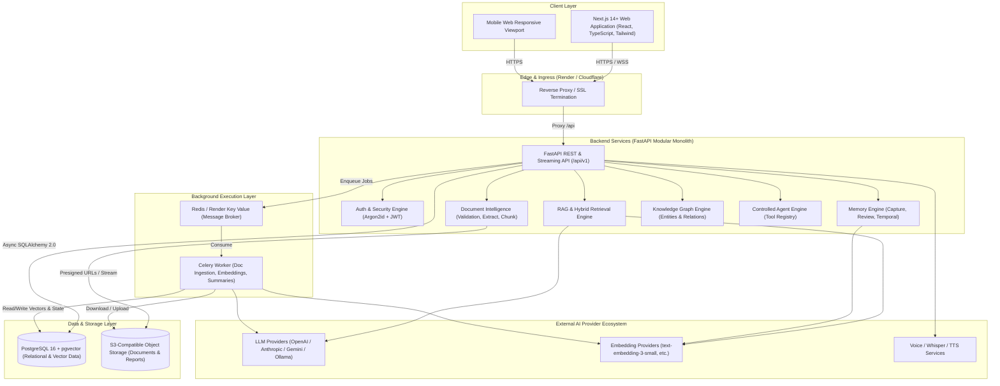

# AI-MemoryVerse — System Architecture

## 1. High-Level Architecture Overview

AI-MemoryVerse is designed as a high-performance **modular monolith** with clear boundary separation between domain layers. It leverages FastAPI for backend API performance, Next.js for a responsive React user interface, PostgreSQL with `pgvector` for unified relational and vector data, and Celery with Redis for asynchronous background processing.

---

## 2. Component Architecture Breakdown

### 2.1 Frontend Architecture (`frontend/`)
- **Framework:** Next.js (App Router), React 18/19, TypeScript.
- **Styling:** Tailwind CSS with a cohesive dark-first theme (navy/slate/cyan palette) using accessible Radix UI primitives.
- **State Management:**
  - Server Cache & Synchronization: **TanStack Query v5** for optimistic updates, caching, and auto-refetching.
  - Client Application State: **Zustand** for active workspace selection, sidebar states, and audio playback.
  - Form Handling: **React Hook Form** with strict **Zod** schema validation.
- **Streaming UI:** Native Fetch API `ReadableStream` reader for streaming token-by-token AI responses.

### 2.2 Backend Architecture (`backend/app/`)
- **FastAPI Core:** Async ASGI server providing auto-generated OpenAPI documentation, CORS middleware, strict request ID tracking, and unified exception handling.
- **Layered Decoupling:**
  - `api/v1/`: HTTP routers declaring schemas, status codes, and path parameters.
  - `services/`: Business logic layer orchestrating database models, AI pipelines, and validations.
  - `models/`: SQLAlchemy 2.0 declarative database entities.
  - `schemas/`: Pydantic v2 schemas for strict payload typing and serialization.
  - `ai/`: Independent AI subsystem with pluggable provider adapters (`LLMProvider`, `EmbeddingProvider`).

### 2.3 Data Layer & pgvector Integration
- **PostgreSQL 16 with `pgvector`**:
  - Relational tables manage identity, access controls, memory metadata, document chunks, conversation messages, entities, and audit logs.
  - `vector(1536)` columns on `memory_embeddings` and `document_embeddings` enable cosine similarity searches using `HNSW` or `IVFFlat` indexes.
  - PostgreSQL full-text search (`tsvector` and `tsquery`) provides keyword search capability.
  - **Hybrid Search**: Combines vector cosine similarity with lexical full-text search using Reciprocal Rank Fusion (RRF).

### 2.4 Document Processing Pipeline
1. **Upload Initiation:** Client requests a secure upload token or presigned S3 URL from `/api/v1/documents/upload-url`.
2. **Quarantine & Validation:** Backend inspects magic bytes, file size limits (e.g., 25MB max), and verifies allowed file extensions (`.pdf`, `.docx`, `.xlsx`, `.pptx`, `.txt`, `.md`, `.csv`).
3. **Queue Enqueue:** A Celery task is enqueued with the document ID; status updates to `PROCESSING`.
4. **Text Extraction:** Specialized extractors extract raw text and retain page/table structural metadata.
5. **Context-Aware Chunking:** Text is split using recursive character chunking (default 500 tokens with 10% overlap).
6. **Vector Embedding:** Batches of chunks are passed to the configured `EmbeddingProvider`.
7. **Indexing & Completion:** Chunks and embeddings are stored transactionally in PostgreSQL. Document status updates to `READY`.

### 2.5 Multi-Tenant Security & Isolation
- Every database query in services must filter by `workspace_id`.
- Foreign keys and unique composite constraints enforce multi-tenant isolation at the database schema level.
- Authorization middleware enforces Role-Based Access Control (RBAC): `Owner`, `Admin`, `Member`, `Viewer`.
