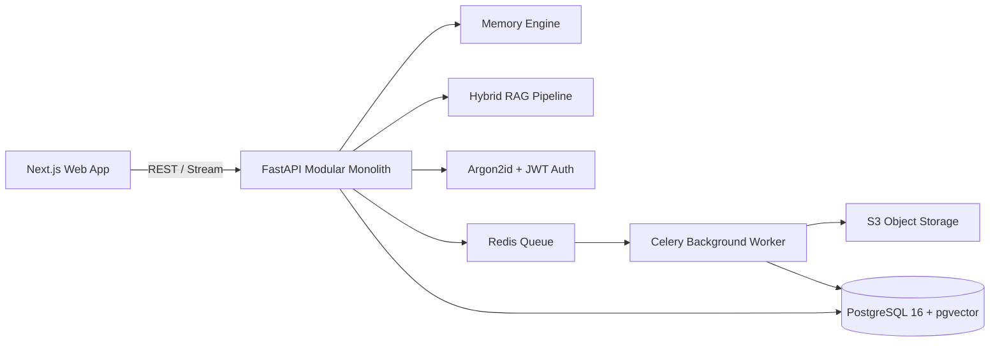

# AI-MemoryVerse 🌌

> **Remember. Connect. Understand. Retrieve.**  
> *The Commercial-Grade Personal AI Memory & Knowledge Intelligence Platform.*

[](https://github.com/BharathR/AI-MemoryVerse/actions)
[](LICENSE)
[](https://www.python.org/)
[](https://nextjs.org/)
[](https://github.com/pgvector/pgvector)
[](https://render.com)

---

## 1. Project Introduction
**AI-MemoryVerse** is a full-stack, enterprise-grade AI knowledge system designed to act as an external brain. Unlike transient chat interfaces, AI-MemoryVerse persistently remembers user-approved facts, categorizes memories across episodic, semantic, project, and preference domains, processes heterogeneous multi-format documents asynchronously, extracts knowledge graphs, and retrieves information with verified source citations.

---

## 2. Product Vision
Modern LLMs suffer from transient context windows, hallucinated assertions, and lack of genuine personal continuity. AI-MemoryVerse solves this through:
- **Human-in-the-Loop Memory Engineering:** Inferred facts require review before entering persistent memory.
- **Temporal Memory Reasoning:** Tracks when facts were true, superseded, or updated.
- **Source-Grounded Retrieval:** Merges semantic vector embeddings with PostgreSQL full-text search, enforcing tenant workspace boundaries and validating citations.

---

## 3. Core Features
- 🧠 **Intelligent Memory Engine:** Automatic extraction, classification, conflict detection, and version control.
- 💬 **Streaming Contextual AI Chat:** Low-latency conversational intelligence with verified citations and memory preview.
- 📄 **Document Intelligence:** Asynchronous parsing of PDF, DOCX, XLSX, PPTX, TXT, Markdown, and CSV into vectorized chunks.
- 🕸️ **Knowledge Graph Explorer:** Visual, interactive exploration of entity relationships and provenance links.
- 🎙️ **Voice Intelligence:** Whisper-compatible speech-to-text and streaming voice synthesis.
- 🛡️ **Zero-Trust Multi-Tenancy:** Workspaces, RBAC, Argon2id encryption, and audit logs.
- 📊 **Operational Analytics:** True database metrics on memory growth, token usage, and retrieval precision.

---

## 4. System Architecture
AI-MemoryVerse is built as a **Modular Monolith** designed for developer ergonomics and deployment simplicity:



---

## 5. Technology Stack
- **Frontend:** Next.js 14+ (App Router), React, TypeScript, Tailwind CSS, shadcn/ui, TanStack Query v5, Zustand, Lucide Icons.
- **Backend:** Python 3.11+ / FastAPI, Pydantic v2, SQLAlchemy 2.0 (Async), Celery.
- **Data & Vector Layer:** PostgreSQL 16 with `pgvector` extension.
- **Message Broker & Cache:** Redis 7 / Render Key Value.
- **Storage:** S3-compatible Object Storage (AWS S3 / Cloudflare R2 / MinIO) with local fallback.
- **Authentication:** Argon2id password hashing, JWT HttpOnly sessions.
- **DevOps & Deployment:** Docker, Docker Compose, GitHub Actions, Render Blueprint (`render.yaml`).

---

## 6. Application Workflow & Architecture
See [ARCHITECTURE.md](file:///Users/BharathR/AI-MemoryVerse/ARCHITECTURE.md) for detailed sequence diagrams, ER models, and subsystem breakdowns.

---

## 7. Database Design
PostgreSQL tables are partitioned logically across:
- **Identity:** `users`, `user_profiles`, `user_sessions`, `workspaces`, `workspace_members`.
- **Memories:** `memories`, `memory_versions`, `memory_sources`, `memory_reviews`, `memory_links`, `memory_embeddings`.
- **Documents:** `documents`, `document_versions`, `document_chunks`, `document_embeddings`, `document_processing_jobs`.
- **Graph:** `entities`, `entity_relations`, `entity_mentions`.
- **Conversations:** `conversations`, `messages`, `conversation_summaries`.
- **Operations:** `audit_logs`, `ai_usage_logs`, `plans`, `subscriptions`.

---

## 8. Local Setup & Quick Start

### 1. Clone Repository & Setup Environment
```bash
git clone https://github.com/BharathR/AI-MemoryVerse.git
cd AI-MemoryVerse
cp .env.example .env
```

### 2. Run with Docker Compose
```bash
docker compose up -d
```
The application will be live at:
- Frontend: `http://localhost:3000`
- Backend API Docs: `http://localhost:8000/docs`
- Healthcheck: `http://localhost:8000/health`

---

## 9. Environment Variables
See [.env.example](file:///Users/BharathR/AI-MemoryVerse/.env.example) for the complete list of configuration options.

---

## 10. Database Migrations
Migrations are managed with Alembic:
```bash
cd backend
# Run all pending migrations
alembic upgrade head

# Generate a new migration
alembic revision --autogenerate -m "Add new table"
```

---

## 11. AI Provider Setup
Configure your preferred provider in `.env`:
```env
# For local offline testing:
LLM_PROVIDER=mock
EMBEDDING_PROVIDER=mock

# For Google Gemini:
LLM_PROVIDER=gemini
LLM_API_KEY=your_gemini_key
LLM_MODEL=gemini-1.5-flash

# For OpenAI:
LLM_PROVIDER=openai
LLM_API_KEY=your_openai_key
LLM_MODEL=gpt-4o-mini
```

---

## 12. Testing
Execute unit, integration, and security test suites:
```bash
# Backend tests
cd backend
pytest -v

# Frontend tests
cd frontend
npm test
```

---

## 13. Render Production Deployment
This repository includes a production-ready [render.yaml](file:///Users/BharathR/AI-MemoryVerse/render.yaml) Blueprint:
1. Link your GitHub repository in Render.
2. Select **New Blueprint Instance**.
3. Fill in secret environment variables (`SECRET_KEY`, `LLM_API_KEY`, S3 credentials).
4. Deploy!

---

## 14. Security & Compliance
Read our comprehensive [SECURITY.md](file:///Users/BharathR/AI-MemoryVerse/SECURITY.md) for details on our threat model, SSRF defenses, prompt injection mitigations, and tenant isolation policies.

---

## 15. License
MIT License. See `LICENSE` for details.
