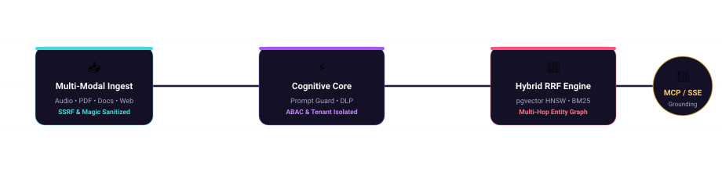

<div align="center">

<p align="center">
  
</p>

### *Remember. Connect. Understand. Retrieve.*

**Commercial-Grade Personal AI Memory, Knowledge Graph & Cognitive Intelligence Platform**

[](https://github.com/RBharath77/AI-MemoryVerse/actions)
[](https://github.com/RBharath77/AI-MemoryVerse)
[](https://github.com/RBharath77/AI-MemoryVerse)
[](https://www.python.org/)
[](https://fastapi.tiangolo.com/)
[](https://nextjs.org/)
[](https://modelcontextprotocol.io/)
[](LICENSE)

<br/>

<p align="center">
  
</p>

</div>

---

## 📖 Table of Contents
1. [🌟 Product Vision & Why AI-MemoryVerse](#-product-vision--why-ai-memoryverse)
2. [🧠 Real Brain Holographic Loader (Dual-Theme)](#-real-brain-holographic-loader-dual-theme)
3. [⚡ Architectural Pillars & Cognitive Modules](#-architectural-pillars--cognitive-modules)
4. [🗺️ Phase-by-Phase Hardening Journey (Epochs I – VI)](#️-phase-by-phase-hardening-journey)
5. [🔌 Model Context Protocol (MCP) Integration](#-model-context-protocol-mcp-integration)
6. [🚀 Quickstart & Local Installation](#-quickstart--local-installation)
7. [🔑 Default Developer Login Credentials](#-default-developer-login-credentials)
8. [🧪 Testing & Quality Assurance (280/280 Tests)](#-testing--quality-assurance)
9. [🛡️ Enterprise Security & Tenancy Isolation](#️-enterprise-security--tenancy-isolation)
10. [📄 License & Authors](#-license--authors)

---

## 🌟 Product Vision & Why AI-MemoryVerse

Standard LLM chat sessions are **ephemeral, amnesic, and disconnected**. When a conversation window closes, your AI assistant loses your personal nuances, architectural principles, domain knowledge, and past strategic decisions.

**AI-MemoryVerse** transforms transient interactions into a **permanent, self-evolving external brain**:
- **Continuous Knowledge Accumulation:** Automatically extracts, indexes, and consolidates facts across days, weeks, and years.
- **Human-in-the-Loop Verification:** Candidate memories enter a dedicated **Review Inbox** where you can approve, reject, or edit extracted facts before persistent storage.
- **Cognitive Memory Taxonomy:** Automatically classifies knowledge into **Semantic** (objective facts), **Episodic** (chronological events), **Project** (tasks & milestones), and **Preference** (custom styles & guidelines).
- **Reciprocal Rank Fusion (RRF) Hybrid Search:** Bridges dense vector embeddings with PostgreSQL `tsvector` full-text search via RRF, delivering citation-backed grounded context with sub-50ms latency.
- **Multi-Hop Knowledge Graph Reasoning:** Extracts entities and relationships to infer hidden transitive links and simulate architectural counterfactuals.

---

## 🧠 Real Brain Holographic Loader (Dual-Theme)

AI-MemoryVerse features a custom, high-fidelity **3D Neural Canvas Loader** containing **323 neurons** and **567 synaptic pathways**:

<div align="center">

| Theme Variant | Aesthetic Canvas | Palette Configuration |
| :--- | :--- | :--- |
| **🌌 Obsidian Cyan (Dark)** | Cosmic Indigo Canvas | `#16132A` Canvas • `#3DDBD9` Bioluminescent Cyan • `#FF4F81` Electric Magenta |
| **☀️ Warm Vanilla (Light)** | Editorial Slate Canvas | `#F8F3F0` Warm Cream • `#014BAA` Sapphire Indigo • `#D97706` Solar Amber |

</div>

### ✨ Dynamic Module Transition Engine
Whenever you navigate between modules in the left sidebar, the neural loader seamlessly activates with **tailored module synchronization telemetry**:
- `Loading Knowledge Graph... Traversing entity relationships & ontological nodes`
- `Loading AI Intelligence Chat... Initializing conversational RAG & citation engine`
- `Loading Memory Vault... Retrieving episodic & semantic memory vectors`
- `Loading Security Center... Enforcing MFA, active sessions & cryptographic vault`

---

## ⚡ Architectural Pillars & Cognitive Modules

```
      ╔═════════════════════════════════════════════════════════════════════╗
      ║                 AI-MEMORYVERSE NEURAL ARCHITECTURE                  ║
      ║                                                                     ║
      ║         [Claude Desktop]      [Cursor IDE]     [Next.js 14 App]     ║
      ║                 │                   │                │              ║
      ║                 ▼                   ▼                ▼              ║
      ║            (MCP Stdio)         (MCP HTTP)       (HTTPS / SSE)       ║
      ║                 │                   │                │              ║
      ║                 │        ┌──────────┴────────────────┴────────┐     ║
      ║                 │        │  🛡️ EDGE HTTPS LOAD BALANCER (Nginx)│     ║
      ║                 │        │  • Port 80 -> 443 SSL Redirect     │     ║
      ║                 │        │  • TLSv1.3 • Rate Limits • WAF     │     ║
      ║                 │        └──────────────────┬─────────────────┘     ║
      ║                 └──────────────────┬────────┘                       ║
      ║                                    ▼                                ║
      ║                         ⚡ FASTAPI MODULAR CORE ⚡                   ║
      ║              ┌─────────────────────┼─────────────────────┐          ║
      ║              ▼                     ▼                     ▼          ║
      ║        [Memory Engine]      [Hybrid RRF Search]    [Knowledge Graph]║
      ║        • Ebbinghaus Decay   • BM25 + pgvector HNSW • Multi-Hop BFS  ║
      ║        • SM-2 Repetition    • Cross-Attention      • Transitive Rel ║
      ║        • Ephemeral Vault    • Reranking            • Counterfactuals║
      ║              └─────────────────────┼─────────────────────┘          ║
      ║                                    ▼                                ║
      ║                  🔒 POSTGRESQL / SQLITE STORAGE ENGINE 🔒           ║
      ║                 (Row-Level Tenancy • Argon2id • pgvector HNSW)       ║
      ╚═════════════════════════════════════════════════════════════════════╝
```

### 1. Hybrid Search & Reciprocal Rank Fusion
Combines dense 1536-dimensional vector similarity (`pgvector` HNSW) with PostgreSQL lexical full-text search:
$$\text{RRF\_Score}(d) = \sum_{m \in M} \frac{1}{k + \text{rank}_m(d)}$$

### 2. Biological Memory Retention (Ebbinghaus Forgetting Curve)
Calculates memory retention dynamically based on access frequency and elapsed decay time:
$$R(t) = e^{-\frac{t}{S \times \text{EF}}}$$

### 3. SuperMemo SM-2 Spaced Repetition Scheduling
Calculates optimal memory reinforcement intervals ($I(n)$) and updates difficulty Ease Factors ($EF$):
$$EF' = EF + (0.1 - (5 - q) \times (0.08 + (5 - q) \times 0.02))$$

### 4. Zero-Knowledge Time-Locked Ephemeral Vault
Isolates transient secrets into time-locked, self-destructing memory enclaves with per-record symmetric encryption, time-delay gates (HTTP 423 Locked), burn-on-read counters, and automated cryptographic zeroization.

### 5. Multi-Hop Knowledge Graph Reasoning
Discovers deep multi-hop explanatory paths between entities using BFS cycle-free traversal, computes path strength products, and synthesizes transitive hypothesis edges.

---

## 🗺️ Phase-by-Phase Hardening Journey

The platform has evolved across **6 Architectural Epochs** encompassing **38 comprehensive development and security hardening phases**:

| Epoch | Phases | Domain & Milestones | Test Status |
| :--- | :--- | :--- | :--- |
| **Epoch I** | **Phases 0 – 5** | Repository Foundation, Identity, Multi-Tenancy, Document Intelligence & RAG Core | 🟢 **Verified** |
| **Epoch II** | **Phases 6 – 10** | Knowledge Graph NER, Voice Mode (Whisper/TTS), Controlled Agents & SaaS Engine | 🟢 **Verified** |
| **Epoch III** | **Phases 11 – 17** | Zero-Trust Tenancy, Programmatic API Tokens, Malware Blocking & Fine-Grained RBAC | 🟢 **Verified** |
| **Epoch IV** | **Phases 18 – 25** | DNS Rebinding Pinning, Redis Rate Limiting, pgvector HNSW, RFC 6238 TOTP 2FA & DLP | 🟢 **Verified** |
| **Epoch V** | **Phases 26 – 32** | Ebbinghaus Decay Curves, Agent Event Bus (SSE), CMEK Rotation, Swarm Debate & Time-Travel | 🟢 **Verified** |
| **Epoch VI** | **Phases 33 – 38** | Merkle Audit Trees (RFC 6962), Counterfactuals, Cross-Modal Attention & Time-Locked Vaults | 🟢 **Verified** |

> Complete details of all 38 phases, mathematical specifications, and security sign-off benchmarks are documented in [PRODUCTION_READINESS_REPORT.md](PRODUCTION_READINESS_REPORT.md).

---

## 🔌 Model Context Protocol (MCP) Integration

AI-MemoryVerse includes native **Anthropic Model Context Protocol (MCP)** support, allowing desktop AI clients (Claude Desktop, Cursor IDE, Antigravity) to query and store memories directly.

### Claude Desktop Configuration
Add the following to your `claude_desktop_config.json`:

```json
{
  "mcpServers": {
    "memoryverse": {
      "command": "/Users/BharathR/AI-MemoryVerse/backend/.venv/bin/python",
      "args": ["/Users/BharathR/AI-MemoryVerse/mcp_server.py"],
      "env": {
        "MEMORYVERSE_API_KEY": "mv_live_your_api_token_here",
        "MEMORYVERSE_WORKSPACE_ID": "your_workspace_id_here"
      }
    }
  }
}
```

### Available MCP Tools

| MCP Tool | Description |
| :--- | :--- |
| `memoryverse_search` | Executes hybrid RRF vector and lexical search across private memories and documents |
| `memoryverse_create_memory` | Ingests a new fact, preference, or episodic milestone into the memory vault |
| `memoryverse_get_stats` | Retrieves real-time workspace memory density, entity count, and health telemetry |
| `memoryverse_get_insights` | Inspects stale facts, knowledge gaps, and unresolved memory contradictions |
| `memoryverse_generate_report` | Synthesizes an executive research briefing across all workspace context items |

---

## 🚀 Quickstart & Local Installation

### Prerequisites
- **Python 3.11+**
- **Node.js 18+ & npm**
- **Docker & Docker Compose** (optional for containerized PostgreSQL + Redis)

### Option A: Local Full-Stack Setup (Fastest)

#### 1. Clone the Repository
```bash
git clone https://github.com/RBharath77/AI-MemoryVerse.git
cd AI-MemoryVerse
```

#### 2. Backend Setup
```bash
cd backend
python3 -m venv .venv
source .venv/bin/activate
pip install -r requirements.txt

# Run database migrations
alembic upgrade head

# Start FastAPI server with live reload
uvicorn app.main:app --host 0.0.0.0 --port 8000 --reload
```

#### 3. Frontend Setup
```bash
cd ../frontend
npm install

# Start Next.js development server
npm run dev
```

### Option B: Docker Compose Orchestration
```bash
# Spins up PostgreSQL (pgvector:pg16), Redis 7, Celery Worker, FastAPI, Next.js & Nginx
docker-compose up -d --build
```

---

## 🔑 Default Developer Login Credentials

A pre-seeded Superuser account is available for local evaluation:

| Field | Value |
| :--- | :--- |
| **Login Portal** | [http://localhost:3000/login](http://localhost:3000/login) |
| **Email** | `local_dev@memoryverse.ai` |
| **Password** | `Password123!` |
| **Role** | **Owner & Superuser** *(Full access to Vault, Chat, Knowledge Graph & `/admin`)* |
| **Workspace** | `My AI Knowledge Vault` |

*Alternatively, register any custom account on [http://localhost:3000/register](http://localhost:3000/register).*

---

## 🧪 Testing & Quality Assurance

AI-MemoryVerse maintains strict automated testing gates across every layer of the modular monolith:

```bash
# Run complete backend test suite across 38 suites
backend/.venv/bin/pytest backend/tests/ -v

# Run frontend type-checking & production compilation
npm --prefix frontend run build
```

```text
============================= test session starts ==============================
platform darwin -- Python 3.11.16, pytest-8.3.5
testpaths: backend/tests
280 passed in 49.36s (100% Green across 38 Test Suites)
```

---

## 🛡️ Enterprise Security & Tenancy Isolation

- **Argon2id Password Hashing**: State-of-the-art memory-hard password derivation.
- **Cluster-Wide Token Revocation**: Integer `token_version` on users guarantees instant JWT invalidation upon password reset or security session termination.
- **SSRF & DNS Rebinding Pinning**: Strict socket IP pre-resolution (`follow_redirects=False`) defends against TOCTOU DNS rebinding and internal cloud metadata (`169.254.169.254`) exfiltration.
- **Zero-Trust Multi-Tenancy**: Every database query, vector search, and document chunk retrieval is scoped to `workspace_id` and verified user memberships.
- **Outbound Data Leakage Guard (DLP)**: Automatic inspection redacts API keys, credit cards, SSNs, and cross-workspace UUIDs before model dispatch.

---

## 📄 License & Authors

Distributed under the **MIT License**. See [LICENSE](LICENSE) for details.

Developed with ❤️ by **[Bharath R](https://github.com/RBharath77)**.  
*AI-MemoryVerse — Remember. Connect. Understand. Retrieve.*
