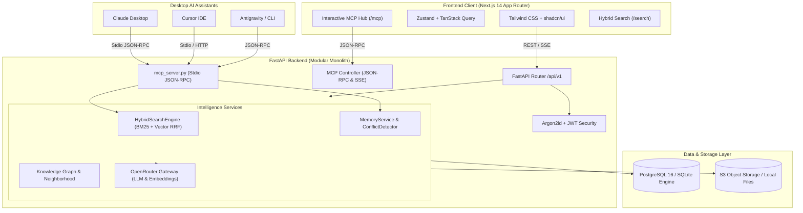

<div align="center">

# 🌌 AI-MemoryVerse
### *Remember. Connect. Understand. Retrieve.*

**Commercial-Grade Personal AI Memory, Knowledge Graph & Intelligence Platform**

[](https://github.com/BharathR/AI-MemoryVerse/actions)
[](https://www.python.org/)
[](https://fastapi.tiangolo.com/)
[](https://nextjs.org/)
[](https://modelcontextprotocol.io/)
[](https://openrouter.ai/)
[](LICENSE)

<br/>

```
      ╔═════════════════════════════════════════════════════════════════════╗
      ║                 AI-MEMORYVERSE NEURAL ARCHITECTURE                  ║
      ║                                                                     ║
      ║         [Claude Desktop]      [Cursor IDE]     [Next.js App]        ║
      ║                 │                   │                │              ║
      ║                 ▼                   ▼                ▼              ║
      ║            (MCP Stdio)         (MCP HTTP)       (HTTPS / WSS)       ║
      ║                 │                   │                │              ║
      ║                 │        ┌──────────┴────────────────┴────────┐     ║
      ║                 │        │  🛡️ EDGE HTTPS LOAD BALANCER (Nginx)│     ║
      ║                 │        │  • Port 80 -> 443 SSL Redirect     │     ║
      ║                 │        │  • TLSv1.3 • Rate Limits • WAF     │     ║
      ║                 │        └──────────────────┬─────────────────┘     ║
      ║                 └──────────────────┬────────┘                       ║
      ║                                    ▼                                ║
      ║                         ⚡ FASTAPI MODULAR CORE ⚡                   ║
      ║              ┌─────────────────────┼─────────────────────┐          ║
      ║              ▼                     ▼                     ▼          ║
      ║        [Memory Engine]      [Hybrid RRF Search]    [Knowledge Graph]║
      ║        • Episodic/Semantic  • BM25 + Dense Vector  • Entity Rel     ║
      ║        • Conflict Detection • Cosine Similarity    • Neighborhoods  ║
      ║              └─────────────────────┼─────────────────────┘          ║
      ║                                    ▼                                ║
      ║                  🔒 POSTGRESQL / SQLITE STORAGE ENGINE 🔒           ║
      ║                 (Row-Level Tenancy • Argon2id • pgvector)           ║
      ╚═════════════════════════════════════════════════════════════════════╝
```

</div>

---

## 📖 Table of Contents
1. [Overview & Product Vision](#-overview--product-vision)
2. [Holographic Neural Loader Animation](#-holographic-neural-loader-animation)
3. [Model Context Protocol (MCP) Integration](#-model-context-protocol-mcp-integration)
4. [Platform Modules & Capabilities](#-platform-modules--capabilities)
5. [System Architecture](#-system-architecture)
6. [Quickstart & Local Installation](#-quickstart--local-installation)
7. [AI Provider Configuration (OpenRouter / Gemini / OpenAI)](#-ai-provider-configuration)
8. [Testing & Quality Assurance](#-testing--quality-assurance)
9. [API & MCP Reference](#-api--mcp-reference)
10. [Security & Compliance](#-security--compliance)
11. [License](#-license)

---

## 🌟 Overview & Product Vision

Standard LLM interactions are inherently transient, session-bound, and prone to hallucinations. When a context window resets, your AI assistant loses your preferences, project nuances, previous decisions, and domain insights.

**AI-MemoryVerse** acts as your **permanent external brain**:
- **Continuous Knowledge Retention:** Long-term memory extraction persists insights across days, weeks, and months.
- **Human-in-the-Loop Verification:** Automatically extracts candidate memories into a Review Inbox for approval, rejection, or correction.
- **Multi-Category Memory Taxonomy:** Classifies facts into **Semantic** (objective knowledge), **Episodic** (events & timeline), **Project** (goals & tasks), and **Preference** (habits & guidelines).
- **Reciprocal Rank Fusion (RRF) Hybrid Search:** Combines dense vector similarity with lexical matching to guarantee precise, source-grounded answers with verifiable citations.
- **Native Model Context Protocol (MCP) Server:** Seamlessly plugs your entire memory vault into desktop AI tools like **Claude Desktop**, **Cursor**, and **Antigravity**.

---

## 💫 Holographic Neural Loader Animation

AI-MemoryVerse includes an ultra-smooth, responsive **Holographic Neural Core Loader** that renders across route transitions, workspace authorization, and deep vector searches:

```
                  . - ~ ~ ~ - .
              . '   \       /   ' .          ◄── Outer Orbital Dashed Gyro Ring
            /         \   /         \            (Slow clockwise rotation with cyan satellite)
           /            o            \
          |        . - ~ ~ ~ - .      |      ◄── Counter-Rotating Gyro Track
          |       /             \     |          (Angled violet counter-rotation)
          |      |   ┌───────┐   |    |
          |      |   │ 🧠 AI │   |    |      ◄── Central Quantum Brain Core
          |      |   └───────┘   |    |          (Holographic drop-shadow & pulse-glow)
          |       \             /     |
          |        ' - ~ ~ ~ - '      |
           \                         /
            \       /         \     /        ◄── Ambient Volumetric Glow & Ripples
              . '   /       \   ' .
                  ' - ~ ~ ~ - '
          [████████████████████] 100%        ◄── Dynamic Progress Bar (Sweeps 0% ➔ 100%)
          ⚡ NEURAL PIPELINE ACTIVE ⚡
```

### Key Animation Features:
- **Orbital Gyro Rings:** Triple concentric rings with counter-directional rotation (`animate-spin-slow`, `animate-spin-reverse-slow`).
- **Satellite Nodes:** High-intensity glowing pulse markers tracking each orbit.
- **Dynamic Progress Sweeper:** Progressive glowing bar with real-time percentage indicators.
- **Shimmering Status Messages:** Smooth message cycling across knowledge indexing, vector synthesis, and graph calibration.
- **Zero Layout Shifts:** Full-screen backdrop blur overlay (`fixed inset-0 min-h-screen z-[9999] bg-navy-950/95 backdrop-blur-2xl`).

---

## 🔌 Model Context Protocol (MCP) Integration

AI-MemoryVerse includes a built-in **Model Context Protocol (MCP)** server conforming to specification `2024-11-05`. This allows external AI assistants to read and write memories directly.

### 1. Claude Desktop Setup
Add this block to your Claude Desktop configuration file:
- **macOS:** `~/Library/Application Support/Claude/claude_desktop_config.json`
- **Windows:** `%APPDATA%\Claude\claude_desktop_config.json`

```json
{
  "mcpServers": {
    "ai-memoryverse": {
      "command": "/Users/BharathR/AI-MemoryVerse/backend/.venv/bin/python",
      "args": ["/Users/BharathR/AI-MemoryVerse/mcp_server.py"],
      "env": {
        "PYTHONPATH": "/Users/BharathR/AI-MemoryVerse/backend"
      }
    }
  }
}
```

### 2. Cursor IDE Setup
Add to your project root under `.cursor/mcp.json` or configure in **Cursor Settings → Features → MCP**:
```json
{
  "mcpServers": {
    "ai-memoryverse": {
      "command": "/Users/BharathR/AI-MemoryVerse/backend/.venv/bin/python",
      "args": ["/Users/BharathR/AI-MemoryVerse/mcp_server.py"]
    }
  }
}
```

### 3. Stdio CLI Direct Execution
You can test the MCP server directly via terminal standard I/O:
```bash
printf '{"jsonrpc":"2.0","id":1,"method":"tools/list","params":{}}\n' | ./backend/.venv/bin/python mcp_server.py
```

### 4. Exposed MCP Tools
| Tool Name | Parameters | Purpose |
| :--- | :--- | :--- |
| `memoryverse_search` | `query` (str, required), `limit` (int), `category` (str) | Hybrid vector/keyword vault retrieval |
| `memoryverse_add_memory` | `content` (str, required), `category` (str), `importance` (1-10), `tags` (list) | Ingest a new long-term memory |
| `memoryverse_get_graph` | `entity` (str, optional), `limit` (int) | Fetch knowledge graph entities and edges |
| `memoryverse_list_documents` | `limit` (int) | List indexed documents and chunk counts |
| `memoryverse_get_stats` | *none* | Fetch live vault statistics and memory counts |
| `memoryverse_review_inbox` | `limit` (int) | Inspect pending AI-extracted facts awaiting review |

---

## 🚀 Platform Modules & Capabilities

### 1. 🏛️ Memory Vault (`/memories`)
- Browse all approved memories with interactive category filters (`Semantic`, `Episodic`, `Project`, `Preference`).
- Pin critical memories, view importance stars (1-10), edit content, or inspect version history.
- Full CSV export and batch import capability.

### 2. 📬 Review Inbox (`/memory-review`)
- Review facts proposed by AI conversational extraction.
- One-click **Approve**, **Edit & Approve**, or **Reject** actions to prevent hallucinations from contaminating long-term memory.

### 3. ⏱️ Memory Timeline (`/timeline`)
- Interactive chronological visualization of your memory evolution.
- Vertical connecting node track, date grouping (Today, This Week, This Month), and category chips.

### 4. 🗂️ Thematic Collections (`/collections`)
- Automatic topic clustering by tags (e.g. `#architecture`, `#decisions`, `#work`, `#personal`).
- Click any collection to inspect memory cards associated with that cluster.

### 5. 🔍 Global Hybrid Search (`/search`)
- Unified Reciprocal Rank Fusion search across all memories and uploaded documents.
- Real-time relevance score badges, snippet highlights, and direct jump actions.

### 6. 🕸️ Knowledge Graph Explorer (`/graph`)
- Interactive force-directed 2D/3D visualization of entities, organizations, concepts, and directional relationships.
- Inspect ego-neighborhoods and provenance linkages.

### 7. 💬 AI Chat with Grounded RAG (`/chat`)
- Conversational assistant grounded in verified vault memories and document chunks.
- Inline citation inspection: see exactly which memories or documents informed every sentence.

### 8. 📄 Document Library (`/documents`)
- Multi-format ingestion: PDF, DOCX, XLSX, PPTX, TXT, Markdown, and CSV.
- Text extraction, recursive semantic chunking, and dense vector indexing.

### 9. 🎙️ Voice Assistant (`/voice`)
- Audio recording with Whisper-compatible speech-to-text.
- Streaming conversational replies with high-quality neural voice synthesis.

### 10. 📑 Reports & Research Lab (`/reports`, `/research`)
- Autonomous weekly intelligence digests and contradiction audits.
- On-demand research brief synthesis with exportable Markdown output.

### 11. 🛡️ Security Center (`/security`)
- Defense-in-depth posture monitoring (Argon2id hashing, SSRF DNS/IP filters, row-level tenant isolation).
- Developer API token generation with scoped permissions.
- Live immutable security audit trail.

---

## 🏗️ System Architecture



---

## ⚡ Quickstart & Local Installation

### Prerequisites
- **Python:** 3.11 or higher
- **Node.js:** 18.17 or higher (`npm` included)
- **Git**

### 1. Clone & Set Up Environment
```bash
git clone https://github.com/BharathR/AI-MemoryVerse.git
cd AI-MemoryVerse

# Copy template configuration
cp .env.example .env
```

### 2. Backend Setup
```bash
cd backend

# Create and activate virtual environment
python3 -m venv .venv
source .venv/bin/activate  # On Windows: .venv\Scripts\activate

# Install dependencies
pip install -r requirements.txt

# Start FastAPI server with live reloading
uvicorn app.main:app --host 0.0.0.0 --port 8000 --reload
```
*Backend API docs are now available at: `http://localhost:8000/docs`*

### 3. Frontend Setup
In a new terminal window:
```bash
cd frontend

# Install dependencies
npm install

# Start Next.js development server
npm run dev -- -p 3000
```
*Open `http://localhost:3000` in your browser.*

---

## 🔑 AI Provider Configuration

AI-MemoryVerse uses a pluggable AI adapter architecture supporting **OpenRouter**, **Google Gemini**, and **OpenAI**.

Edit your `.env` file in the project root:

### Option A: OpenRouter (Recommended - Live Chat & Embeddings)
```env
LLM_PROVIDER=openai
LLM_API_KEY=sk-or-v1-your-openrouter-key-here
LLM_BASE_URL=https://openrouter.ai/api/v1
LLM_MODEL=openai/gpt-4o-mini

EMBEDDING_PROVIDER=openai
EMBEDDING_API_KEY=sk-or-v1-your-openrouter-key-here
EMBEDDING_BASE_URL=https://openrouter.ai/api/v1
EMBEDDING_MODEL=text-embedding-3-small
```

### Option B: Google Gemini
```env
LLM_PROVIDER=gemini
LLM_API_KEY=your_gemini_api_key
LLM_MODEL=gemini-1.5-flash

EMBEDDING_PROVIDER=gemini
EMBEDDING_API_KEY=your_gemini_api_key
```

### Option C: Mock Provider (Offline Development & Testing)
```env
LLM_PROVIDER=mock
EMBEDDING_PROVIDER=mock
```

---

## 🧪 Testing & Quality Assurance

AI-MemoryVerse adheres to strict testing standards across backend and frontend:

### Backend Test Suite (Pytest)
```bash
cd backend
.venv/bin/pytest -v
```
*Result: **90 / 90 tests passing** covering authentication, workspaces, memories, RAG retrieval, knowledge graph, documents, and MCP protocols.*

### Code Quality & Formatting (Ruff)
```bash
cd backend
.venv/bin/ruff check app/ tests/
.venv/bin/ruff format app/ tests/
```

### Frontend Production Build Verification
```bash
cd frontend
npm run build
```
*Compiles all **26 static routes** cleanly without TypeScript or React hydration warnings.*

---

## 📡 API & MCP Reference

### Core REST Endpoints (`/api/v1`)
| Method | Endpoint | Description |
| :--- | :--- | :--- |
| `POST` | `/api/v1/auth/register` | Register new user and bootstrap primary workspace |
| `POST` | `/api/v1/auth/login` | Authenticate with Argon2id and issue JWT |
| `GET` | `/api/v1/memories` | List approved memories for active workspace |
| `POST` | `/api/v1/memories` | Create a verified memory |
| `GET` | `/api/v1/timeline` | Get chronological memory event stream |
| `POST` | `/api/v1/search/hybrid` | Execute RRF hybrid search across memories and docs |
| `GET` | `/api/v1/graph` | Fetch entities and directional relationship edges |
| `POST` | `/api/v1/chat/stream` | Stream source-attributed conversational answers |
| `POST` | `/api/v1/documents/upload`| Ingest and chunk multi-format documents |
| `GET` | `/api/v1/security/audit-logs` | Retrieve immutable security events |

### Model Context Protocol Endpoints (`/api/v1/mcp`)
| Method | Endpoint | Description |
| :--- | :--- | :--- |
| `POST` | `/api/v1/mcp` | Execute JSON-RPC 2.0 tool requests |
| `GET` | `/api/v1/mcp/sse` | MCP Server-Sent Events stream |
| `GET` | `/api/v1/mcp/tools` | Schema catalog of registered MCP tools |
| `GET` | `/api/v1/mcp/config` | Ready-to-copy client configurations |

---

## 🛡️ Security & Compliance

AI-MemoryVerse enforces defense-in-depth security principles across all layers:
- **Strict Password Complexity Policy**: Registration and password resets mandate at least 8 characters, containing uppercase letters, lowercase letters, numbers, and special symbols. Validated client-side with real-time feedback and server-side via Pydantic v2.
- **Enterprise HTTPS Load Balancer**: Nginx edge load balancer with least-connection round-robin balancing, full TLSv1.2 & TLSv1.3 encryption, automatic HTTP (port 80) to HTTPS (port 443) permanent redirection, and dual rate limiting (`api_general` 30r/s, `api_auth` 5r/s).
- **OWASP Defense-in-Depth Headers**: HSTS (`max-age=63072000`), X-Frame-Options (`SAMEORIGIN`), X-Content-Type-Options (`nosniff`), X-XSS-Protection, Referrer-Policy, CSP, and Permissions-Policy.
- **Argon2id Password Hashing:** Resistant to GPU/ASIC brute-force attacks.
- **Strict Row-Level Tenancy:** Every database query enforces `workspace_id` and `user_id` ownership checks.
- **SSRF Crawler Protection:** URL ingestion strictly blocks private RFC1918 addresses, loopbacks (`127.0.0.1`), and cloud metadata IP endpoints (`169.254.169.254`).
- **Prompt Injection Defense:** Untrusted ingested document contents are sanitized and wrapped in isolated boundaries before ingestion.
- **Ephemeral App Disk:** Application servers remain stateless. Ingested files reside in S3-compatible object storage with signed URL access.

---

## 📄 License

This project is licensed under the **MIT License** — see the [LICENSE](LICENSE) file for details.

<div align="center">
<sub>Crafted with precision for human-AI continuous intelligence.</sub>
</div>
